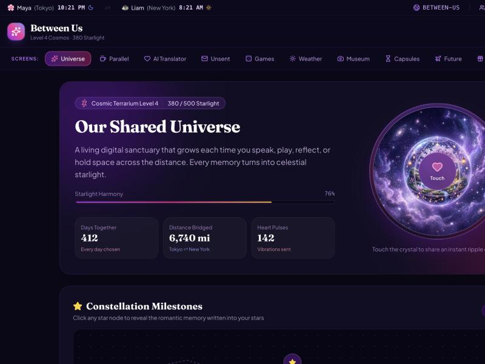
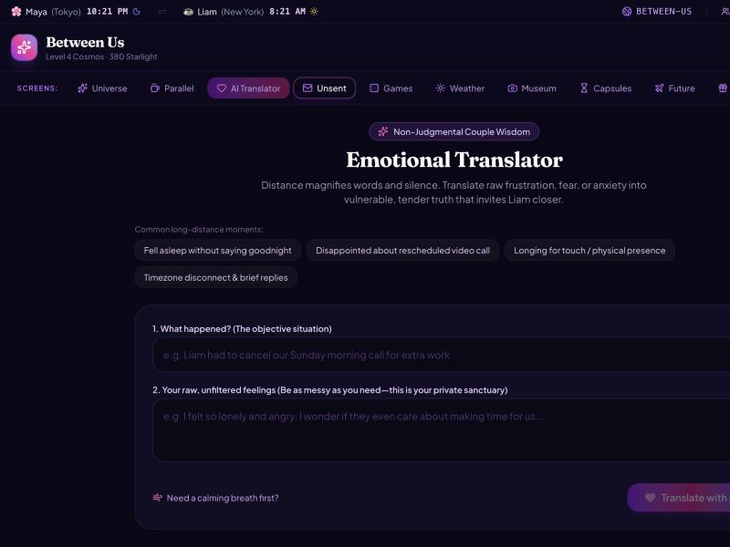
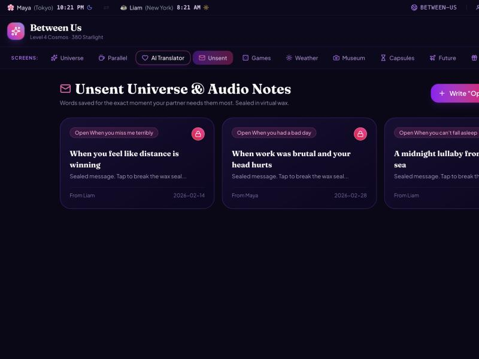

# Between Us

An interactive shared space for long-distance couples: a "universe" you both grow, live parallel dates, an AI emotional translator, games, unsent letters, time capsules and more.



| AI Translator | Unsent letters |
|---|---|
|  |  |

*The screenshots show the built-in demo couple (Maya and Liam).*

## Features

Ten tabs, each a different way to feel close:

- **Universe**: shared dashboard with starlight points and a universe level that grow as you use the app.
- **Parallel**: start a coffee, meal or study session together with a shared timer.
- **AI Translator**: Gemini rewrites what you meant to say into something your partner will hear well.
- **Unsent**: write letters that stay unsent until you choose to open them.
- **Games**: shared game sessions that earn starlight points.
- **Weather**: set a mood and a note for your day; your partner sees it.
- **Museum**: a shared gallery of memories.
- **Capsules**: time capsules locked until you unlock them.
- **Future**: a shared bucket list of things to do together.
- **Surprise AI**: Gemini generates a surprise idea for the two of you.

Also: heartbeat "pulses" you can send each other, and a couple code that links two people to the same space. Installable as a PWA (`public/manifest.json`).

## Tech stack

- React 19, TypeScript, Vite, Tailwind CSS 4, Motion, lucide-react
- Express server (`server.ts`) serving the API and the Vite app
- Google Gemini via `@google/genai` (server-side only)

## Quick start

Requires Node.js and a Gemini API key.

```bash
npm install --legacy-peer-deps   # plain `npm install` hits a peer-dependency conflict
cp .env.example .env   # then set GEMINI_API_KEY
npm run dev
```

Open http://localhost:3000 (set `PORT` to change it).

Other scripts: `npm run build`, `npm run start`, `npm run lint` (type-check).

## Configuration

| Variable | Purpose |
|---|---|
| `GEMINI_API_KEY` | Required for the AI Translator and Surprise AI |
| `APP_URL` | Hosted URL of the app (used when deployed) |
| `PORT` | Server port, defaults to 3000 |

Without an API key the app still runs: the AI Translator and Surprise AI fall back to built-in responses.

## How it works

Couple data (profiles, memories, capsules, letters, games, bucket list) lives in server memory, keyed by couple code. It resets when the server restarts. The browser talks to `/api/couple/:code/...` endpoints; the Gemini calls go through `/api/gemini/translate-emotion` and `/api/gemini/generate-surprise`, so the key never reaches the client.

## Project structure

```
server.ts          Express API + Gemini calls + Vite middleware
src/App.tsx        Tab shell and app state
src/components/    One component per tab, plus header and modals
src/utils/         Audio helpers
public/            PWA manifest and assets
```
